<!--
  GitHub 个人主页 README ｜ w441295m-eng
  说明：仓库名需与用户名一致（w441295m-eng），此 README 才会渲染在个人主页。
  图片统一放 assets/，用相对路径引用；横幅按系统深浅色自动切换（<picture>）。
  改完运行 tools/preview.py 生成 preview.html 本地核对。
-->

<p align="center">
  <picture>
    <source media="(prefers-color-scheme: dark)" srcset="./assets/banner-dark.svg" />
    <source media="(prefers-color-scheme: light)" srcset="./assets/banner-light.svg" />
    
  </picture>
</p>

<p align="center">
  
  
  
  
</p>

## 关于我

<table>
  <tr>
    <td width="164" valign="top">
      
    </td>
    <td valign="top">
      <p><b>「先把事情做成，再把它做好。」</b></p>
      <p>我是<b>九熙雨（JXY）</b>，做 <b>AI 应用开发</b>。判断一个技术值不值得用，只有一个标准：它有没有真的解决那个问题。</p>
      <p>所以我不太写「调通 API」的 Demo —— 模型要能被压缩、能被降级、能被监控，接口要能扛住重试和并发，界面要让人一眼看懂。从数据到模型、从接口到部署，这条链路我一个人走得完。</p>
    </td>
  </tr>
</table>

- **AI 落地，而不是跑通 demo** —— 在点餐系统 2.0plus 里把 `bert-base-chinese` 情感分析真正接进业务：训练 → 蒸馏 → INT8 量化 → 剪枝实验，线上模型从 **390 MB 压到 91 MB**；单例懒加载 + CPU 推理 + 加载失败自动降级，评论提交链路永远不被模型拖垮。
- **用数字做技术选型** —— 文本分类项目里，同一份数据跑完随机森林 / FastText / 中文 BERT 微调 / DeepSeek API 四条路线：BERT **0.9495**、DeepSeek **0.66**。结论是「自己微调的模型离线、可批量、零调用成本」，而不是「哪个最热用哪个」。
- **服务化是硬要求** —— FastAPI + SQLAlchemy 2.0 + Pydantic 2 做分层，JWT 鉴权、限流、幂等键、软删除、令牌版本失效都补齐。模型能力最终要变成一个敢给人调的接口。
- **一个人能交付** —— Vue 3 + Vite + Element Plus + Pinia 自己写，也保留原生 HTML/CSS/JS 手写能力；Java / Spring Boot 的底子在，读别人的后端服务不费劲。

## 技术栈

| 方向 | 具体能力 | 阶段 |
| :--- | :--- | :---: |
| **AI 应用工程** | LLM API 接入与调用编排 · Prompt 设计 · RAG 检索链路 · LangChain · 向量库（Qdrant） | **在用** |
| **模型与 NLP** | `bert-base-chinese` 微调 · 知识蒸馏 · INT8 量化 · 结构化剪枝 · FastText · 多路线评测 | **有落地** |
| **后端服务化** | FastAPI · SQLAlchemy 2.0 · Pydantic 2 · Java / Spring Boot · MyBatis · JWT · 限流 / 幂等 | **主力** |
| **前端** | Vue 3 · Vite · Element Plus · Pinia · Axios · 原生 HTML / CSS / JavaScript | **熟练** |
| **数据** | MySQL 8（索引 · 分页 · 事务 · LONGBLOB） · Redis（缓存 · TTL · 兜底） | **熟练** |
| **工程化** | Git · Docker · uv / pip · Maven · Apifox · CLI 与迁移脚本 · 降级与日志设计 | **日常** |

<p align="center">
  
  
  
  
  
  
</p>

<p align="center">
  
  
  
  
  
  
  
  
</p>

## 代表项目

<table>
  <tr>
    <td>
      <h3>01 ｜ 膳遇点餐系统 <sub>v2.0plus · MIT · 全栈 + AI 情感分析</sub></h3>
      <p><b>做了什么</b> —— 一套前后端分离的在线点餐平台（菜品分类、购物车批量结算、订单管理、评论星级、三级权限），2.0plus 在它上面长出了一个真正跑在业务里的 AI 模块。</p>
      <p><b>AI 模块怎么落地的</b> —— 评论提交后由后端调用 <code>bert-base-chinese</code> 微调模型自动判定正负情感，配套四段式模型流水线：<code>train_bert.py</code>（390 MB）→ <code>distill.py</code>（174 MB）→ <code>quantize.py</code>（INT8，91 MB，线上实际加载）→ <code>prune.py</code>（剪枝实验）。工程侧做了单例懒加载、CPU 推理、加载失败返回 <code>None</code> 不阻断评论、历史评论批量回填；管理端可按情感筛选并统计正负占比。</p>
      <p><b>顺手补的工程债</b> —— 登录失败 5 次锁 15 分钟、slowapi 分级限流、<code>token_version</code> 令牌即时失效、时序攻击防护、越权接口修复、下单幂等键、软删除、评论以 MySQL 为唯一数据源（Redis 降级为 60 秒读缓存）。</p>
      <p><b>技术栈</b> —— Vue 3.4 / Vite 5 / Element Plus / Pinia ｜ FastAPI / SQLAlchemy 2.0 / Pydantic 2 ｜ MySQL 8 + Redis ｜ PyTorch + Transformers ｜ JWT + bcrypt</p>
      <p>
        <a href="https://gitee.com/MYC_CM/shan-yu-dian-can/tree/2.0plus"></a>
        <a href="https://gitee.com/MYC_CM/shan-yu-dian-can/blob/2.0plus/CHANGELOG.md"></a>
      </p>
    </td>
  </tr>
</table>

<table>
  <tr>
    <td>
      <h3>02 ｜ project-nlp <sub>文本分类 · 四条技术路线横向评测</sub></h3>
      <p><b>做了什么</b> —— 在<b>同一份</b>头条新闻数据上，把随机森林、FastText、中文 BERT 微调、DeepSeek API 四条路线训练到底，用统一指标对比精度 / 延迟 / 成本，并且把结论写成了可复现的工程。</p>
      <p><b>结论由数字支撑</b> —— 中文 BERT 微调 <b>acc 0.9495</b>，DeepSeek API 反而只有 <b>0.66</b>；自己微调的模型离线、可批量、零调用成本、数据不外传。压缩实验里，蒸馏出的 BiLSTM 只有 <b>38 MB</b>、单条推理 <b>5.3 ms</b>；剪枝 / 量化后精度基本不掉。</p>
      <p><b>不止跑实验</b> —— 训练好的模型包成 <b>Flask 预测 API + Streamlit 页面</b>（单条 / 批量），依赖用 <code>uv</code> 锁定；结论与图表都由 <code>results/</code> 里的真实数字支撑，换台机器能复现。</p>
      <p><b>技术栈</b> —— PyTorch（CUDA）· Transformers 5.x · scikit-learn · fastText · Flask · Streamlit · uv</p>
      <p>
        <a href="https://gitee.com/The_Jade_Emperor/text_classification"></a>
      </p>
    </td>
  </tr>
</table>

<p><sub>GitHub 上的仓库还在整理中，完整代码与提交历史目前托管在 <a href="https://gitee.com/MYC_CM">Gitee</a>；能公开的部分会陆续迁到这里，迁完第一件事就是把它们 Pin 到主页顶部。</sub></p>

## 我怎么做事

<table>
  <tr>
    <td width="34%" valign="top">
      <h4>先问「值不值」，再问「怎么做」</h4>
      上模型之前先算账：这个场景用规则、用小模型、还是用大模型？成本和延迟能不能接受？选型写下来，比事后解释便宜。
    </td>
    <td width="33%" valign="top">
      <h4>让 AI 出错也不致命</h4>
      模型会挂、会慢、会给错答案。所以加载要有降级、调用要有超时、结果要能回填重算 —— 业务链路不该被一个模型拖死。
    </td>
    <td width="33%" valign="top">
      <h4>端到端交付</h4>
      需求 → 数据 → 模型 → 接口 → 界面 → 部署，一个人串完。少一层沟通损耗，多一分对最终结果负责的底气。
    </td>
  </tr>
</table>

## 近况

```bash
$ cat now.txt
[在做]  把 LLM 能力包成可复用的服务：检索链路 + 工具调用 + 失败兜底
[在学]  Agent 编排与评测 —— 关心的是「怎么证明它比昨天更可靠」
[在补]  测试、CI 与可观测性，把「能跑」推进到「能交付」
[在写]  踩坑记录与技术笔记，发在 CSDN
```

## 联系我

```bash
$ contact --all
email    →  3389393468@qq.com
github   →  github.com/w441295m-eng
gitee    →  gitee.com/MYC_CM
blog     →  blog.csdn.net/weixin_62393776
```

<p>
  <a href="mailto:3389393468@qq.com"></a>
  <a href="https://github.com/w441295m-eng"></a>
  <a href="https://gitee.com/MYC_CM"></a>
  <a href="https://blog.csdn.net/weixin_62393776"></a>
</p>

聊 AI 应用落地、模型选型、或者只是想把一个想法做出来，都欢迎来信。

<div align="center">
  
  <br />
  <sub>先把事情做成，再把它做好。 · Last updated 2026-10</sub>
</div>
